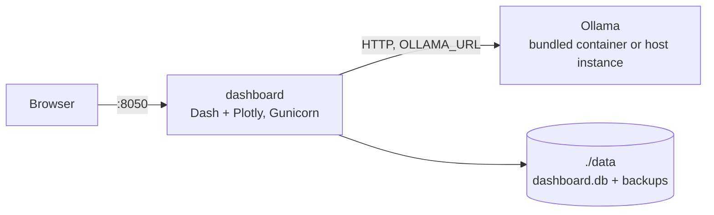

# AI-Powered Financial Dashboard

A personal finance dashboard with written insights from a local LLM. Your data never leaves your machine.


## Overview

The dashboard stores transactions in a local SQLite database. It renders interactive charts and financial indicators from them. On request, a local model served by [Ollama](https://ollama.com) reads aggregated metrics and writes a short commentary. Everything runs in Docker on your own host.

## Features

- **Interactive charts.** Spending by category and payment method, monthly trends, installments starting and ending.
- **Local AI insights.** An Ollama model comments on the last 12 months. Only aggregated metrics reach the model.
- **Payment methods.** Credit cards with statement closing and payment days, and debit accounts.
- **Installment-aware.** Multi-installment purchases are split into monthly records with computed payment dates.
- **Graceful degradation.** If the model is unreachable or out of memory, a deterministic summary is shown instead.
- **Transactional storage.** One SQLite file on the host; every change is one transaction.
- **Automatic backups.** A daily snapshot, plus one before every edit or delete, with a one-command restore.
- **Mobile-friendly.** Single-column layout on phones, touch-sized controls, installable with its own icon.
- **Optional privacy lock.** An in-app password screen, independent of network-level authentication.

## Architecture



`OLLAMA_URL` points either at a bundled Ollama container or at an instance already running on the host. See [Choosing how to run Ollama](#choosing-how-to-run-ollama).

## Requirements

- Docker Desktop (Windows, macOS) or Docker Engine with the Compose plugin (Linux)
- About 8 GB of free disk for the model and images
- About 6 GB of free RAM for the default `llama3.2:3b`; more for larger models
- Internet access on the first run, to pull images and the model

## Getting started

### 1. Clone the repository

```bash
git clone https://github.com/cassianorcarneiro/ai-powered-financial-dashboard.git
cd ai-powered-financial-dashboard
```

### 2. Prepare the data folder

The database is created automatically on first start, in `data/`. Nothing needs to be prepared by hand.

To start from the bundled samples, copy them before the first start:

```bash
mkdir -p data
cp examples/data.example.csv            data/data.csv
cp examples/categories.example.csv      data/categories.csv
cp examples/payment_methods.example.csv data/payment_methods.csv
```

> [!NOTE]
> **Migrating from the CSV version.** If `data/` contains `data.csv`, `categories.csv` and `payment_methods.csv`, they are imported on first start. The import runs in one transaction and is verified: row count and total amount must match the source. On failure, nothing is written and startup stops with an explicit message. On success, the files are renamed to `*.csv.migrated`, kept, and never re-imported.

Expected CSV headers:

| File | Required columns |
|---|---|
| `data.csv` | `Transaction Date;Payment Date;Label;Category;Amount;Installment;Payment Method;Hash;Record Timestamp;Ignore Entry` |
| `categories.csv` | `Name` |
| `payment_methods.csv` | `Name;Close Date;Payment Date;Type` |

Use `;` as the separator and UTF-8 with BOM, which Excel opens correctly. Expenses are negative amounts; income is positive.

### 3. Configure the environment

```bash
cp .env.example .env
# set the Ollama endpoint, model, port, time zone and currency
```

### 4. Start

Pick one mode.

**Bundled Ollama.** The stack starts its own Ollama and pulls the model:

```bash
docker compose --profile bundled-ollama up -d --build
```

**Existing Ollama.** The dashboard reuses an instance already running on the host:

```bash
docker compose up -d --build
```

Verify with `docker compose ps`. The first run takes a few minutes, mostly to download the model (~2 GB for the default).

### 5. Open the dashboard

Go to <http://localhost:8050>. **Generate AI Insight** analyzes the last 12 months. The first call can take 10–30 seconds while the model loads into memory.

## Choosing how to run Ollama

| | Bundled Ollama | Existing Ollama |
|---|---|---|
| Command | `docker compose --profile bundled-ollama up -d` | `docker compose up -d` |
| `OLLAMA_URL` | `http://ollama:11434` | Host address (below) |
| Model pulled automatically | Yes | No: run `ollama pull <model>` |
| GPU | CPU only, unless you uncomment the `deploy` block in `docker-compose.yaml` | Whatever the host instance already uses |

Reusing a host instance is usually better when that instance already has GPU access. A containerized Ollama without a device reservation runs on CPU, which is much slower.

A host instance needs two changes:

**1. Listen on an address containers can reach.** By default Ollama binds to `127.0.0.1`, which is unreachable from a container. On a systemd host:

```bash
sudo systemctl edit ollama.service
```

```ini
[Service]
Environment="OLLAMA_HOST=172.17.0.1:11434"
```

```bash
sudo systemctl daemon-reload && sudo systemctl restart ollama.service
```

Binding to the Docker bridge address, not `0.0.0.0`, keeps the API off your LAN and VPN interfaces. Ollama has no authentication, so the narrow bind matters. Confirm the bridge address with `ip addr show docker0`.

**2. Point `OLLAMA_URL` at that address** in `.env`:

| Host OS | Value |
|---|---|
| Linux | `http://172.17.0.1:11434` |
| macOS, Windows | `http://host.docker.internal:11434` |

## Configuration

All runtime settings are environment variables in `.env`.

| Variable | Default | Purpose |
|---|---|---|
| `DASHBOARD_PORT` | `8050` | Host port of the dashboard |
| `OLLAMA_URL` | `http://ollama:11434` | Ollama endpoint |
| `OLLAMA_MODEL` | `llama3.2:3b` | Model used for insights |
| `OLLAMA_TIMEOUT` | `120` | Seconds to wait for a completion |
| `TZ` | `UTC` | Time zone of the "last update" timestamp |
| `CURRENCY` | `BRL` | Currency code passed to the model |
| `CURRENCY_SYMBOL` | `R$` | Symbol on chart axes and tooltips |
| `REQUEST_PASSWORD` | `0` | `1` enables HTTP basic authentication |
| `DASHBOARD_USERS` | *(empty)* | Comma-separated `user:password` pairs |
| `BACKUP_DIR` | `data/backups` | Snapshot directory |
| `BACKUP_INTERVAL_HOURS` | `24` | Interval between scheduled snapshots |
| `BACKUP_KEEP_SCHEDULED` | `14` | Scheduled snapshots kept |
| `BACKUP_KEEP_SAFETY` | `20` | Safety snapshots kept |
| `BACKUP_SAFETY_MIN_MINUTES` | `60` | Minimum gap between safety snapshots |
| `LOG_LEVEL` | `INFO` | Python logging level |

### Choosing a model

| Model | Size | RAM | Notes |
|---|---|---|---|
| `llama3.2:3b` (default) | ~2 GB | 4–6 GB | Good quality on modest hardware |
| `llama3.1:8b` | ~4.7 GB | 8 GB | More nuanced commentary |
| `mistral:7b` | ~4.1 GB | 8 GB | Strong reasoning |
| `phi3:mini` | ~2.3 GB | 4 GB | Very fast; English-leaning |

To switch, edit `OLLAMA_MODEL` in `.env` and restart with the same command you started with:

```bash
docker compose --profile bundled-ollama up -d   # bundled: model-puller fetches the new model
docker compose up -d                            # host instance: run `ollama pull <model>` first
```

## Data and backups

| What | Where | Survives restarts |
|---|---|---|
| Database | `./data/dashboard.db` (bind mount) | Yes, on the host filesystem |
| Backups | `./data/backups/` or `BACKUP_DIR` | Yes, on the host filesystem |
| Ollama models | `ollama` named volume (bundled profile) | Yes |
| Container filesystem | Inside the container | No |

Every change runs in one SQLite transaction. An interrupted save leaves the previous state, never a partial one. SQLite's write lock serializes concurrent writers, so overlapping requests cannot corrupt the file.

`data/` is git-ignored, so your transaction history is never committed. The samples live in `examples/`, outside it.

> [!WARNING]
> Do not place `data/` on a network share (NFS, SMB). SQLite's WAL mode requires a local filesystem.

### Backups

Two snapshot kinds are pruned independently, so one cannot push the other out:

| Kind | When | Kept |
|---|---|---|
| `scheduled` | At startup, then every `BACKUP_INTERVAL_HOURS` | Newest `BACKUP_KEEP_SCHEDULED` |
| `safety` | Before an edit or delete, at most once per `BACKUP_SAFETY_MIN_MINUTES` | Newest `BACKUP_KEEP_SAFETY` |

Safety snapshots cover a mistake made hours after the last scheduled one. Snapshots use SQLite's online backup API, so they are consistent while the app runs. Each one is verified before it is kept. A failed backup is logged as an error but never blocks your own save or delete.

By default, snapshots sit on the same disk as the database. They protect against mistakes and bugs, not against disk loss. To cover that, set `BACKUP_DIR` to a path on another drive and mount it in `docker-compose.yaml`.

**Restore.** Stop the app first:

```bash
docker compose stop dashboard
docker compose run --rm dashboard python backup.py list
docker compose run --rm dashboard python backup.py restore dashboard-scheduled-YYYYMMDD-HHMMSS.db
docker compose start dashboard
```

The current database is snapshotted before it is replaced, so a wrong restore can itself be undone.

### Exporting data

The database is the source of truth; editing exported CSVs does not change it. To export for Excel or pandas:

```bash
docker compose run --rm dashboard python storage.py export /app/data/export
```

Any SQLite client can also open `data/dashboard.db`. Open it read-only while the app runs.

### Stopping and resetting

```bash
docker compose down                                  # stop; keeps data and models
docker compose --profile bundled-ollama down -v      # also removes the downloaded models
```

`down -v` removes named volumes only. The database in `./data` is a bind mount and is not deleted. To start from an empty database, delete or move `./data` yourself.

## Common operations

```bash
docker compose logs -f dashboard              # dashboard logs
docker compose logs -f ollama                 # Ollama logs (bundled profile)
docker compose up -d --build dashboard        # rebuild after a code change
curl http://localhost:8050/healthz            # health check
```

Models:

```bash
docker exec -it ollama ollama list            # bundled profile
docker exec -it ollama ollama pull mistral:7b
ollama list                                   # host instance
ollama pull mistral:7b
```

Run without Docker:

```bash
python -m venv .venv && source .venv/bin/activate
pip install -r requirements.txt
OLLAMA_URL=http://localhost:11434 python app.py
```

## Troubleshooting

### "Ollama unavailable"

The dashboard cannot reach `OLLAMA_URL`. Test from inside the container:

```bash
docker compose exec dashboard curl -sS "$OLLAMA_URL/api/tags"
```

If this fails while the same request from the host succeeds, the host Ollama is bound to `127.0.0.1`. See [Choosing how to run Ollama](#choosing-how-to-run-ollama).

### "Model busy"

Ollama could not load the model because GPU or system memory is exhausted, usually by another workload. The deterministic summary is shown meanwhile. Retry later, or choose a smaller model.

### "Timeout"

The first call after startup is slow while the model loads. Retry, or raise `OLLAMA_TIMEOUT`.

### "Model not available on the Ollama server"

Pull it: `ollama pull llama3.2:3b`, or `docker exec -it ollama ollama pull llama3.2:3b` with the bundled profile.

### Port 8050 already in use

Set `DASHBOARD_PORT=8080` in `.env`, run `docker compose up -d` and open <http://localhost:8080>.

### Empty charts

The default filter is the current calendar year. Adjust the date inputs, or reset them with the ↺ button.

### Missing column on import

A legacy CSV does not match the expected header. The error names the missing columns. Compare with the table in [Prepare the data folder](#2-prepare-the-data-folder). Nothing is imported until the file is fixed.

### "The database failed its integrity check"

Restore the newest snapshot; see [Backups](#backups).

## Privacy and security

- The database and backups stay on the host filesystem and are excluded from version control.
- The LLM runs locally. No hosted AI provider is called.
- Only aggregated metrics reach the model, never individual transactions.
- The container runs as an unprivileged user.
- After the first run, the dashboard works fully offline.

> [!WARNING]
> HTTP basic authentication sends credentials base64-encoded, which is effectively clear text. Enable it only behind TLS or on a trusted private network such as a VPN. Never commit real credentials.

### Basic auth vs. privacy lock

The two layers address different threats:

| | Basic auth (`REQUEST_PASSWORD`) | Privacy lock (in-app) |
|---|---|---|
| Threat | Someone reaching the dashboard over the network | Someone with physical access to an unlocked device |
| Set via | `.env`, before the container starts | Key and padlock buttons in the running dashboard |
| Checked | Before Dash serves anything | Server-side on every page load, via a Flask session |

The privacy lock stores a salted password hash in `data/lock.json`, which is git-ignored. It does not resist someone who can read the server's files. Enabling the lock takes effect on the next page load; an open tab keeps working until reloaded. The unlocked state is cleared on container restart by design; the password is kept.

## App icon

The tab and home-screen icons are generated from the chart palette in `config.py`.

| File | Used by |
|---|---|
| `icon.svg`, `favicon.ico` | Browser tab (SVG where supported, ICO as fallback) |
| `icon-192.png`, `icon-512.png` | Installed app, unmasked |
| `icon-maskable-192.png`, `icon-maskable-512.png` | Android home screen; the launcher crops to its own shape |
| `apple-touch-icon.png` | iOS home screen, which ignores manifest icons |

The maskable icons keep the artwork inside the central safe zone. To change the design, edit `generate_icons.py` and run it from the project root:

```bash
pip install pillow   # needed only for this step
python generate_icons.py
```

Android keeps a cached icon until the app is removed from the home screen and added again.

## Project structure

```
ai-powered-financial-dashboard/
├── app.py                  # Dash app, callbacks, record generation, entry point
├── config.py               # Environment settings, theme, column schemas
├── storage.py              # SQLite persistence, CSV import and export
├── backup.py               # Snapshots, retention, restore (also a CLI)
├── metrics.py              # Trailing 12-month aggregations
├── insights.py             # Ollama client, prompt, fallback summary
├── security.py             # Privacy lock: password hashing and state
├── charts.py               # Plotly figure factory
├── layout.py               # Dash component tree
├── generate_icons.py       # Regenerates the icon set
├── assets/                 # Served by Dash: CSS, JS, icons, manifest.json
├── examples/               # Sample CSVs
├── data/                   # Database and backups (bind-mounted, git-ignored)
├── requirements.txt
├── Dockerfile              # Non-root image running Gunicorn
├── docker-compose.yaml     # Dashboard, plus optional bundled Ollama
├── .dockerignore
├── .env.example
├── .gitignore
├── LICENSE
└── README.md
```

## Roadmap

- [ ] Excel import
- [ ] Budget vs. actual per category
- [ ] Recurring transaction detection
- [ ] Next-month forecast from scheduled installments
- [ ] Multi-currency support
- [ ] Automated test suite in CI

## License

Released under the [MIT License](LICENSE).

## Author

**Cassiano Ribeiro Carneiro** · [@cassianorcarneiro](https://github.com/cassianorcarneiro)

## AI assistance

Claude (Anthropic) was used to refactor the structure and formatting of this repository. The core logic is the author's own work.
